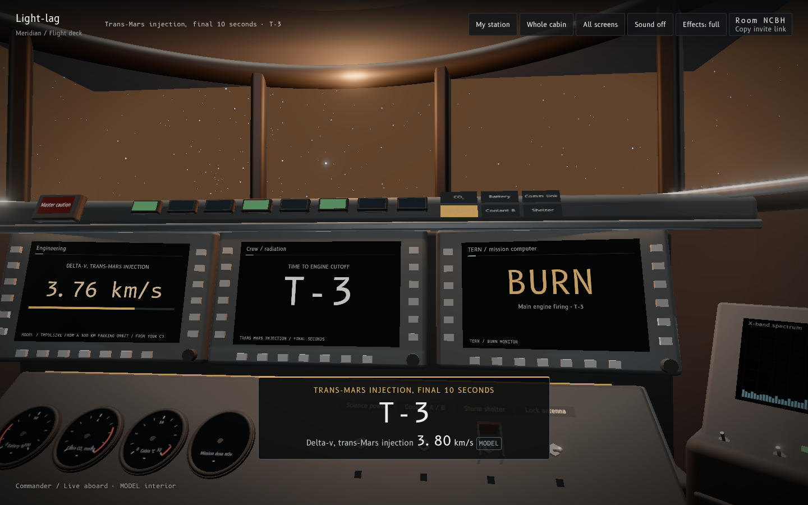
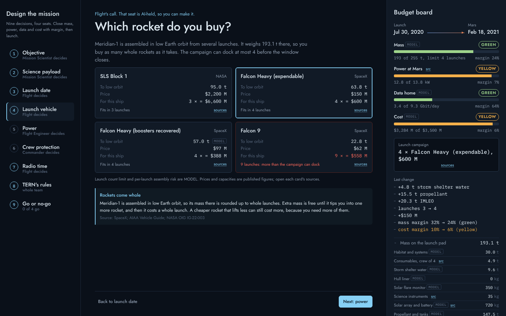
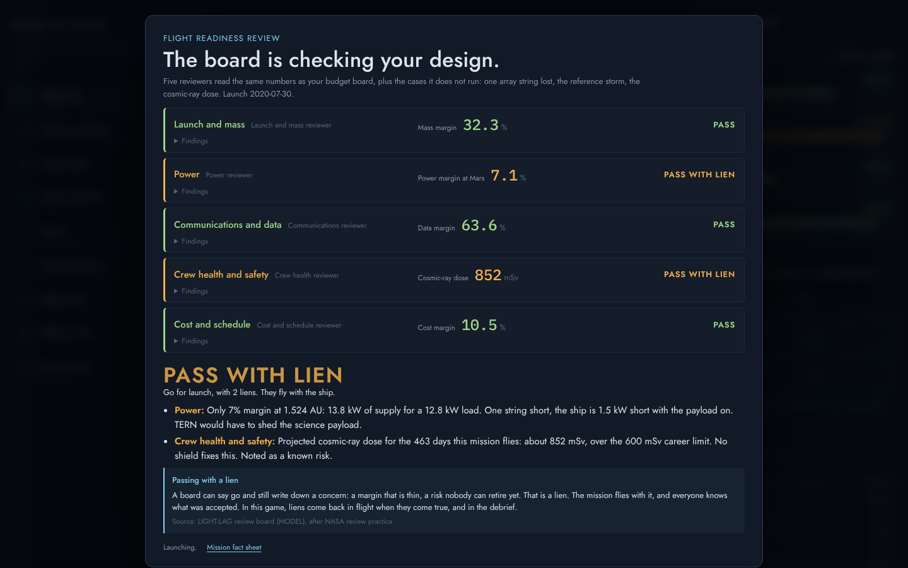
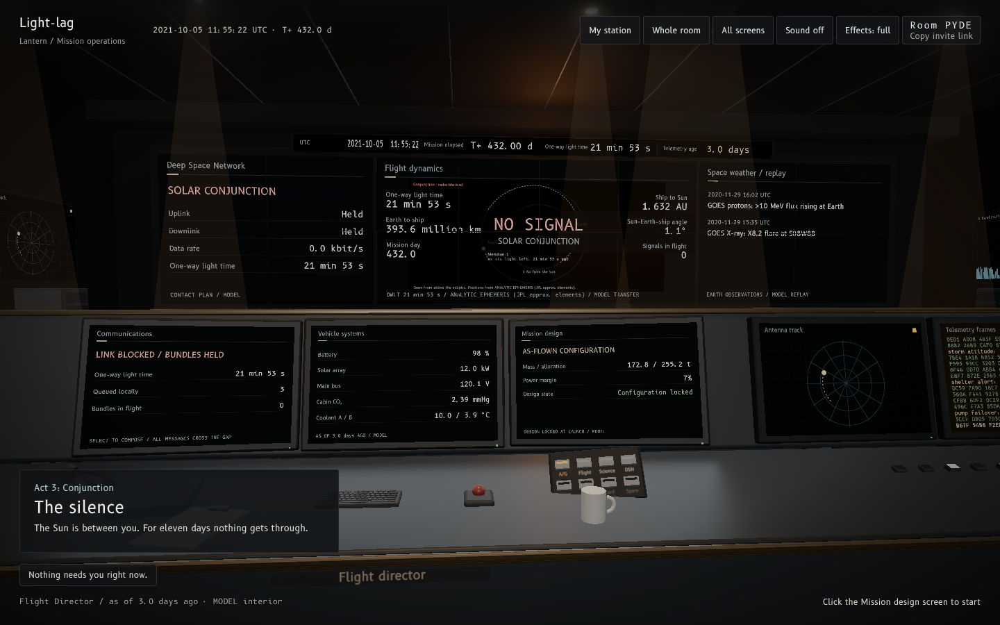
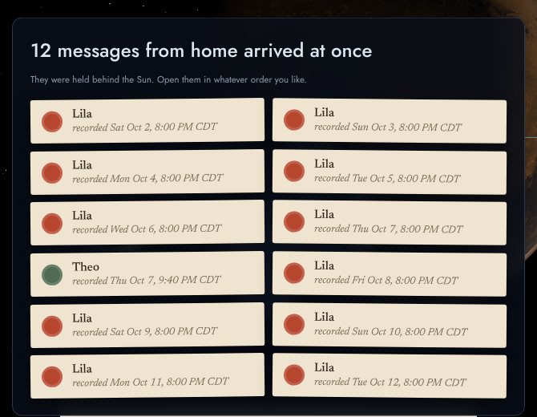
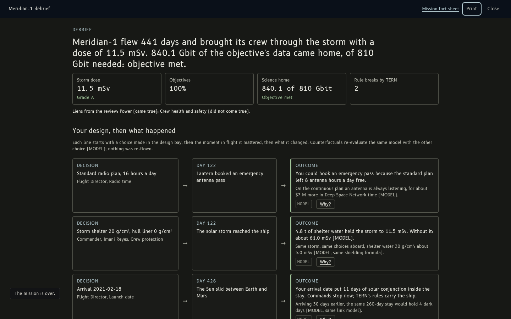
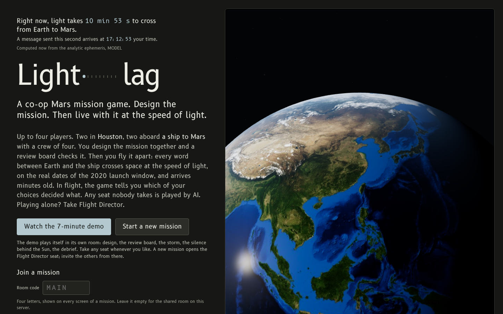
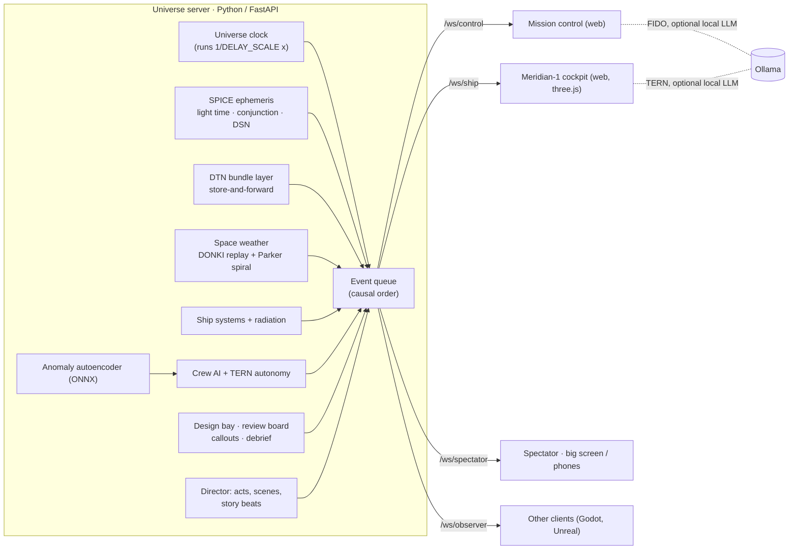

# Light-lag

**Design the mission. Then live with it at the speed of light.**

Light-lag is a free, co-op Mars mission game for classrooms, clubs, families and anyone curious about spaceflight. Up to four people plan a crewed mission to Mars on the real 2020 launch window, then fly it together, with every message between Earth and the ship delayed by the true speed of light. Anyone can play alone: the game fills every empty seat.

**Play in your browser: https://lightlag.byaayushkumar.com**, or [run it on your own computer](#run-it-yourself).



## The story

Commander Imani Reyes is flying to Mars. Her daughter Lila, seven, is at home in Houston. They agree on one rule: say "over" when you're done, so the other side knows.

On Day 5 they can still talk live. By Day 98 every answer takes minutes, and Lila waits up for one. Then the Sun moves between Earth and Mars, and for eleven days nothing gets through at all. Lila records a goodnight every night anyway.

Every delay and every silence in the game happened. The mission flies the same dates as NASA's Perseverance rover.

## How it plays

There are two rooms and four seats. People in the same room talk instantly. Between the rooms, every message waits out the light time.

| Seat | Where | Before launch | In flight |
|---|---|---|---|
| **Flight Director** | Mission control, Houston | Launch date, rocket, radio plan | Talks to the ship, books antenna time, warns about solar storms |
| **Mission Scientist** | Mission control, Houston | The goal and the science instruments | Decides what data comes home first |
| **Commander Imani Reyes** | Aboard Meridian-1 | The storm shelter | Flies the ship, gets the crew to safety, answers Lila |
| **Flight Engineer Daniel Okafor** | Aboard Meridian-1 | Solar arrays and battery | Power, life support and every repair |

A mission has three parts:

1. **Plan.** Pick the rocket, the instruments, the power system, the shielding and the radio plan. Four meters must stay in the green: mass, power at Mars, data home and cost. When everyone says go, a review board checks the plan. If it fails, you fix it and the launch slips.
2. **Fly.** About 440 days pass in short scenes. A solar storm hits and the crew runs for the shelter. The Sun blocks the radio for eleven days. Whatever you send arrives late, and Houston always sees the ship as it was minutes ago.
3. **Debrief.** One screen shows what each of your choices caused, with the numbers. For example: the water you put around the storm shelter held the crew's dose to 11.5 mSv instead of about 61.

| | | |
|---|---|---|
|  |  |  |
| Plan the mission and watch the budgets move | A review board checks the plan before launch | Mission control while the Sun blocks the radio |
|  |  |  |
| When contact returns, every letter arrives at once | The debrief traces each choice to its outcome | The real light time to Mars, right now |

**Playing for the first time?** On the home page, press **Watch the 7-minute demo**. It isn't a video: a real mission starts, played by the game itself in every seat, from planning to debrief. Click any seat to take it over at any moment. To plan your own mission from the start, press **Start a new mission**. You'll be Flight Director, and you can invite others with the four-letter room code shown on every screen.

**Getting around.** Click a screen to use it, and drag to look around. **My station** takes you back to your seat, **Whole room** steps back, and **All screens** lists every screen, including a simple dashboard view. **Effects** switches to lighter graphics on slower computers; the game also does this by itself.

## Built on real data

| Source | What it drives |
|---|---|
| NASA/JPL NAIF SPICE | Where Earth, Mars and the ship are; every light time; the 2020 launch window; the 2021 solar conjunction |
| NASA Deep Space Network | When the big antennas can hear the ship, and how fast data comes home |
| NASA CCMC DONKI and published studies | The solar storm, replayed from the real event of 10 September 2017 |
| MSL RAD (Curiosity's cruise to Mars) | Radiation dose during the trip |
| NASA-STD-3001 | The radiation limits the review board checks |
| NASA Baseline Values and Assumptions | Food, water, oxygen and CO₂ per crew member |
| NASA Blue Marble, Black Marble and 3D Resources | Earth by day and night, and Mars |
| Yale Bright Star Catalogue | The 9,096 real stars outside the window |

Numbers we estimated ourselves are labelled **MODEL** on screen. Full sources: [docs/references.md](docs/references.md) and [docs/data-provenance.md](docs/data-provenance.md).

## How we designed it

We started from one question: what does it feel like when help is always minutes away? Most mission design games end at launch, so we let the plan follow the crew. A choice made before launch comes back months later, in the storm or the silence, as a number that matters. We built the light-delay engine first, then the design bay, the crew, the review board and the debrief, and play-tested at every step.

## Ideas for classrooms and clubs

- Split the class into Houston and the ship, in different rooms or on different sides of the room, and let the delay do the teaching.
- Run the demo on a projector, pause after the storm, and ask: what would you have packed differently?
- Use the debrief and the printable **Mission Fact Sheet** to compare two teams' designs.

## Run it yourself

```bash
pip install -r requirements.txt          # Python 3.11 or newer
python -m tools.fetch_kernels            # once, with internet: NASA SPICE kernels (about 35 MB)
python run.py                            # then open the address it prints
```

Open `/control/` on one computer and `/ship/` on another (any device on the same network works; the home page shows QR codes). `/control/?seat=scientist` and `/ship/?seat=engineer` are the other two seats. `/spectator/` is for a shared screen or a phone, and `/factsheet/` prints the Mission Fact Sheet.

| Command | What it does |
|---|---|
| `python run.py` | Normal play. Time runs 10 times faster, so a 12-minute light time is a 72-second wait |
| `python run.py --judge` | Demo mode: the scripted mission of about 8 minutes, with the game playing any idle seat |
| `python run.py --true` | Real light time on a real clock. Bring a book |
| `python run.py --offline` | Never uses the network; cached data only |
| `python -m tools.fetch_donki` | Download storm data (run `python -m tools.fetch_dsn_now` for a Deep Space Network snapshot) |
| `cd server && python -m pytest -q` | 124 automated tests, including full missions (about 90 s) |

The game works without the kernels (it switches to a labelled approximate ephemeris), without a language model and without internet. Settings are environment variables with safe defaults; see [`.env.example`](.env.example) and `server/lightlag/config.py`. To host it on a public link, see [deploy/README.md](deploy/README.md).

## Known limitations

- **Simplified trajectory.** A two-body transfer arc, then a simple Mars orbit. Light-time errors are seconds near the planets.
- **Simplified shielding.** The cruise dose is a real measurement; shielding and storm profiles are simple models, labelled MODEL in the game.
- **Faster clock.** By default the whole universe runs 10 times faster, so every event keeps its real order. `--true` plays it in real time.
- **An illustrative ship.** Power, thermal and life-support behaviour is tuned for plausible time scales, not taken from a real spacecraft.
- **Cosmic-ray dose.** A 15-month Mars mission exceeds NASA's 600 mSv career limit on cosmic rays alone. The game shows this and does not score it.

## What's in the box



```
run.py  Makefile  requirements.txt  .env.example
server/lightlag/   the universe server: ephemeris, delay-tolerant messaging, ship systems,
                   radiation, crew, science, review board, debrief, story director, API
server/tests/      automated tests
clients/           mission control, the ship, the spectator view, the fact sheet, shared UI
data/              the scenario, story text, the sourced hardware catalogue, reference data
ml/                the onboard anomaly detector and its evaluation
tools/             data download and pre-flight checks
deploy/            hosting on a public link
docs/              design, science and technical notes
```

| Doc | What's in it |
|---|---|
| [docs/game-design.md](docs/game-design.md) | The game: loop, acts, mechanics and scoring |
| [docs/story-bible.md](docs/story-bible.md) | The characters and the six key moments |
| [docs/science.md](docs/science.md) | Every equation the game uses, its source, and how we checked it |
| [docs/architecture.md](docs/architecture.md) | How the server keeps time, orders events and separates what each side knows |
| [docs/ws-api.md](docs/ws-api.md) | The WebSocket and HTTP API |
| [docs/visual-design.md](docs/visual-design.md) | The look, and how the 3D view is built from real geometry |
| [docs/model-card.md](docs/model-card.md) | The onboard assistant and the anomaly model |
| [docs/data-provenance.md](docs/data-provenance.md) | Every NASA source: what, where and its terms |
| [docs/references.md](docs/references.md) | Every bundled asset and design-catalogue source, with its licence |
| [docs/audio-hooks.md](docs/audio-hooks.md) | Sound cues and how the score adapts |

## Credits

Made by team **Goodnight, over** at the NASA Space Apps Challenge 2026 (Cincinnati), for the *Space Mission Design Game* challenge.

**NASA data**
- **NASA/JPL NAIF SPICE:** DE440 planetary ephemeris, naif0012 leap seconds, pck00011 planetary constants, DSN station kernels. Every position and light time in the game.
- **NASA CCMC DONKI** (via api.nasa.gov): solar flare and particle event records for the storm replay.
- **DSN Now** (NASA/JPL-Caltech): the live Deep Space Network panel.
- **MSL RAD:** cruise radiation measured by Curiosity on its way to Mars, Zeitlin et al., *Science* 340:1080 (2013).
- **NASA-STD-3001** and its technical briefs: crew radiation and life-support limits.
- **NASA Life Support Baseline Values and Assumptions** (NASA/TP-2015-218570/REV1): food, water, oxygen and CO₂ per crew member.
- **NASA/JPL release 2021-200:** the dates of the October 2021 Mars solar conjunction.
- **NASA Earth Observatory:** Blue Marble and Black Marble imagery of Earth.
- **NASA 3D Resources:** the Mars colour map.
- **NASA mission pages** for Perseverance, Ingenuity and Mars Reconnaissance Orbiter, used for the real events and hardware figures.

**Science and reference sources**
- Storm parameters for the 10 September 2017 event: Guo et al. (2018); Ackermann et al. (Fermi-LAT); Kurt et al. (see `data/reference/sep_events.yaml`).
- **Yale Bright Star Catalogue**, 5th revised edition, Hoffleit and Warren (1991): the 9,096 stars outside the window.
- Launch vehicle, instrument, power and cost figures come from NASA, JPL, AIAA and manufacturer sources, each cited by key in `data/catalog/sources.yaml`.

**Open source software**
- [three.js](https://threejs.org) (MIT) with its addons for the 3D rooms, the ship and the planets.
- [SpiceyPy](https://github.com/AndrewAnnex/SpiceyPy) (MIT), a Python wrapper for NAIF's CSPICE toolkit.
- [FastAPI](https://fastapi.tiangolo.com) (MIT) and [Uvicorn](https://www.uvicorn.org) (BSD) for the game server.
- [NumPy](https://numpy.org) (BSD), [PyYAML](https://pyyaml.org) (MIT), [httpx](https://www.python-httpx.org) (BSD), [python-multipart](https://github.com/Kludex/python-multipart) (Apache 2.0) and [qrcode](https://github.com/lincolnloop/python-qrcode) (BSD).
- [ONNX Runtime](https://onnxruntime.ai) (MIT) runs the onboard anomaly detector, trained with [PyTorch](https://pytorch.org) (BSD).
- [pytest](https://pytest.org) (MIT) and [skyfield-data](https://github.com/brandon-rhodes/skyfield-data) (MIT) for the test suite.
- Optional, off by default on the public site: [Ollama](https://ollama.com) (MIT) with Qwen3 models (Apache 2.0) for the crew's spoken lines, [whisper.cpp](https://github.com/ggerganov/whisper.cpp) (MIT) for voice notes and [Piper](https://github.com/rhasspy/piper) (MIT) for the radio voice.
- Fonts: Jost, IBM Plex Mono and Newsreader, and [B612 and B612 Mono](https://github.com/polarsys/b612) by The B612 Project Authors, all under the SIL Open Font License.
- The interface follows the design guidelines of [unslop](https://github.com/heydamir/unslop) by Damir Sokolovsky (CC BY 4.0).

Every sound is synthesized in code, and the spacecraft and both rooms are modelled in code. No downloaded 3D models, stock photos or photos of people are used. Every bundled asset and its licence: [docs/references.md](docs/references.md). Every data source, its terms and status: [docs/data-provenance.md](docs/data-provenance.md).

## Use of SI

We used SI (Super Intelligence) tools, Claude by Anthropic and OpenAI Codex, as assistants. They helped write and debug code, build the 3D interface, and assemble data tables and documentation for the repo, and helped prepare our submission text and slides. The concept, the direction, the choice of sources and every final decision were the team's, and the team reviewed, ran and tested everything.

In the game, the crew's assistant (TERN aboard, FIDO in Houston) can use a small open-weight model running locally (Qwen3 through Ollama) only to phrase its lines. It never makes decisions: every decision follows fixed rules that the automated tests check, and every number it says comes from live telemetry. If no model is running, a scripted fallback answers instead, and that is the default on the public site. A small anomaly detector, trained by the team on synthetic telemetry, runs onboard.

No SI-generated images, video, music or voices are used. All imagery is NASA imagery or drawn in code, and spoken lines use the browser's own text-to-speech.

## Licence

Code: MIT (see `LICENSE`). NASA data remains under its own terms. Story text © the team.
